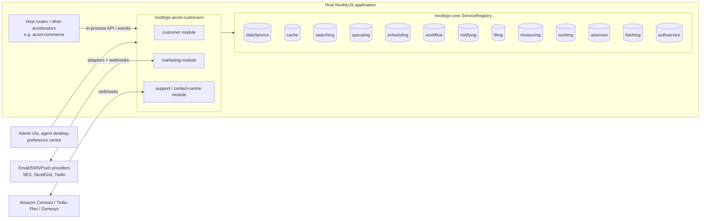
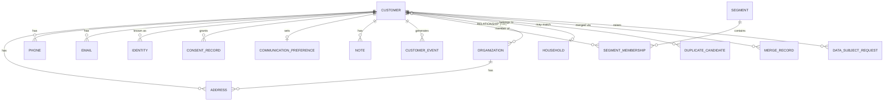
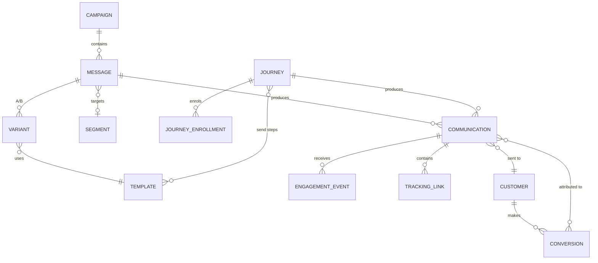
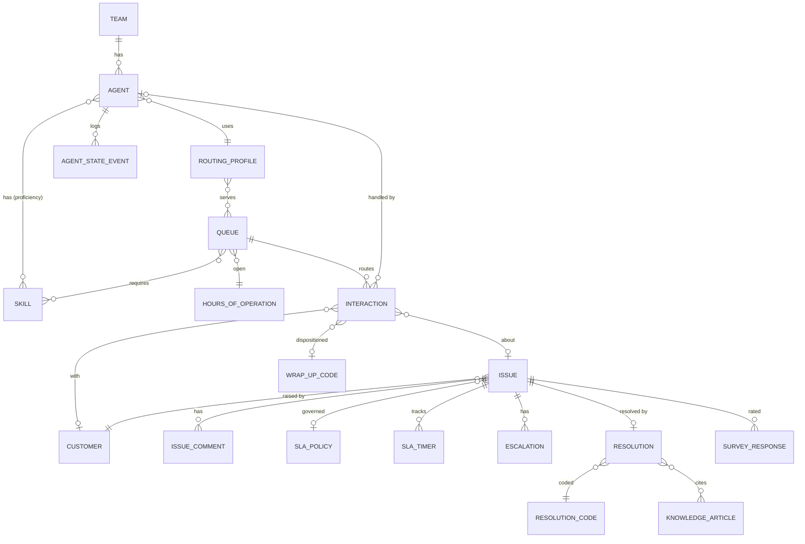
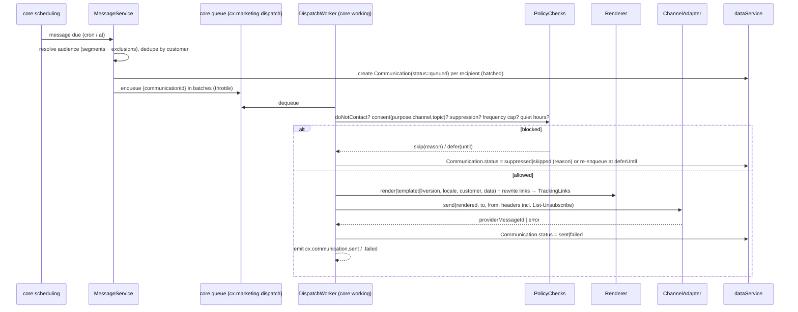
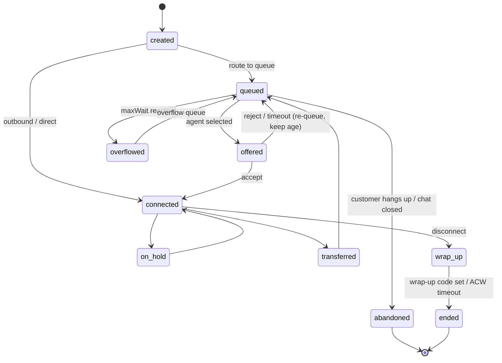

# Customer Accelerator — Architecture

| | |
|---|---|
| **Package** | `nooblyjs-accel-customers` |
| **Status** | Draft v0.1 |
| **Date** | 2026-10-02 |
| **Companion docs** | [PRD](customer-accelerator-prd.md) · [Build Roadmap](customer-accelerator-roadmap.md) |

---

## 1. Architectural principles

1. **Library, not server.** The package exports `mount()`. The host owns the Express app, the EventEmitter and the `ServiceRegistry`. `app.js` in this repo becomes a demo host only.
2. **Core owns infrastructure.** No `fs`, database driver, SMTP or queue client in the accelerator. Every side effect goes through a `nooblyjs-core` service, so provider choice is the host's configuration.
3. **Layered per module:** `routes → services (domain logic) → repositories → core dataService`. Routes never touch repositories. Services never touch `req`/`res`.
4. **Customer is the hub.** `marketing` and `support` depend on `customer`'s public service API, never on its repositories or containers.
5. **Events are the integration contract.** Every state change emits a versioned domain event. Cross-module reactions (e.g. issue resolved → send CSAT) are event subscribers, not direct calls.
6. **Schema-first.** Every object has a declarative schema (fields, types, PII flag, indexes, enums). Validation, masking, indexing, OpenAPI and the UI forms are all generated from it.
7. **Append-only where it matters.** Consent, communications, engagement, agent state, interaction events and audit are immutable ledgers. Current state is derived from them.

## 2. System context



## 3. Package layout (target)

```
nooblyjs-accel-customers/
├── index.js                         # export { mount, schemas, adapters, version }
├── examples/host-app.js             # replaces current app.js (demo host)
├── src/
│   ├── shared/
│   │   ├── context.js               # request context: tenantId, actor, roles, correlationId
│   │   ├── schema/                  # defineSchema(), validate(), mask(), toOpenApi()
│   │   ├── repository/              # BaseRepository, IndexManager, QueryEngine, Counter
│   │   ├── events/                  # DomainEventBus (EventEmitter + notifying + webhooks)
│   │   ├── audit/                   # AuditService (append-only)
│   │   ├── rbac/                    # roles, permissions, requirePermission() middleware
│   │   ├── http/                    # list-query parser, ETag, idempotency, error mapping
│   │   └── ids.js                   # human-readable numbers (CUS-000123, CS-000045)
│   ├── customer/
│   │   ├── index.js                 # module factory → { service, routes, views, subscribers }
│   │   ├── schemas/                 # customer.js, address.js, phone.js, consent.js, ...
│   │   ├── repositories/
│   │   ├── services/                # CustomerService, ContactPointService, ConsentService,
│   │   │                            # IdentityService, SegmentService, MatchMergeService,
│   │   │                            # TimelineService, DsarService, ImportService
│   │   ├── routes/                  # REST + swagger/
│   │   ├── activities/              # working-service jobs: import, segment-eval, dsar
│   │   └── views/                   # admin UI (Bootstrap 5.3 + NooblyJS tokens)
│   ├── marketing/
│   │   ├── schemas/  repositories/  services/  routes/  views/  activities/
│   │   ├── channels/                # ChannelAdapter base + console, smtp, ses, sendgrid, twilio
│   │   ├── pipeline/                # SendPipeline: audience → policy checks → render → dispatch
│   │   ├── journeys/                # JourneyEngine (on core workflow + scheduling)
│   │   ├── templating/              # safe Mustache-style renderer, locale fallback
│   │   └── tracking/                # pixel, click redirect, provider webhooks
│   └── support/
│       ├── schemas/  repositories/  services/  routes/  views/  activities/
│       ├── routing/                 # RoutingEngine + strategies (longest-idle, skills, rr, priority)
│       ├── sla/                     # BusinessCalendar, SlaEngine
│       └── adapters/                # CCaaS webhook adapters (connect, twilio-flex, genesys)
└── tests/  unit/ contract/ ui/
```

> Core's `appservice` auto-discovers `./src/*` relative to `process.cwd()`. That suits apps but not a package in `node_modules`. The accelerator therefore mounts itself explicitly. Its repositories and activities may still extend `appDataBase` / `appWorkerBase` for consistency.

## 4. Mounting and configuration

```js
const serviceRegistry = require('nooblyjs-core');
const customers = require('nooblyjs-accel-customers');

serviceRegistry.initialize(app, eventEmitter, { /* core security options */ });

const cx = await customers.mount(app, eventEmitter, serviceRegistry, {
  modules: ['customer', 'marketing', 'support'],   // marketing/support require customer
  basePath: '/applications',                       // → /applications/customer/api/v1/...
  containerPrefix: 'cx',                           // dataService container namespace
  providers: {                                     // passed to ServiceRegistry factories
    data: { type: 'mongodb', options: { connectionString: process.env.MONGO_URL } },
    cache: { type: 'redis' }, queue: { type: 'redis' }, search: { type: 'memory' },
    filing: { type: 'local', options: { baseDir: './.application/cx-files' } }
  },
  tenancy: { enabled: false, resolve: (req) => req.headers['x-tenant-id'] },
  auth: { roleResolver: (req) => req.user?.roles ?? [] },
  customAttributes: { customer: [{ key: 'loyaltyTier', type: 'enum', values: ['bronze','silver','gold'] }] },
  marketing: {
    channels: { email: customers.adapters.ses({ region: 'eu-west-1' }), sms: customers.adapters.twilio({ /*…*/ }) },
    defaults: { frequencyCap: { count: 3, perDays: 7 }, quietHours: { start: '21:00', end: '08:00' } },
    tracking: { baseUrl: 'https://example.com', signingSecret: process.env.CX_TRACKING_SECRET }
  },
  support: { routing: { defaultStrategy: 'skills', offerTimeoutSec: 20 }, issueNumberPrefix: 'CS' },
  ai: { enabled: true, provider: 'claude' },
  seed: process.env.NODE_ENV !== 'production'
});

// In-process API for the host and other accelerators
await cx.customer.upsertByIdentity({ namespace: 'commerce', value: order.customerId }, profile);
await cx.marketing.sendTransactional({ template: 'order-confirmation', customerId, data: { order } });
cx.events.on('cx.issue.resolved', handler);
```

`mount()` returns `{ customer, marketing, support, events, schemas, shutdown() }`. `shutdown()` stops schedulers, routing loops and listeners. This matches core's `analytics.destroy()` leak discipline.

## 5. Domain model

### 5.1 Standard envelope (all objects)

| Field | Type | Notes |
|---|---|---|
| `id` | string (UUID) | dataService key, also stored in the document |
| `tenantId` | string | `'default'` when tenancy is off |
| `createdAt` / `updatedAt` | ISO-8601 UTC | |
| `createdBy` / `updatedBy` | string | user id, API key id or `system:<job>` |
| `version` | integer | optimistic concurrency; exposed as `ETag` |
| `deletedAt` | ISO-8601 \| null | soft delete |
| `tags` | string[] | |
| `customFields` | object | validated against `AttributeDefinition`s |

### 5.2 Customer domain



**Customer** (individual; Salesforce Person Account / schema.org `Person`)

| Field | Type | Notes |
|---|---|---|
| `number` | string | `CUS-000123`, unique, human-readable |
| `type` | enum | `individual` (Organization is a separate object) |
| `status` | enum | `active`, `inactive`, `blocked`, `merged`, `erased` |
| `lifecycleStage` | enum | `subscriber`, `lead`, `mql`, `sql`, `customer`, `advocate`, `churned` |
| `name` | object | `prefix`, `given`, `middle`, `family`, `suffix`, `preferred`, `full` (derived) — **PII** |
| `dateOfBirth` | date | **PII**, optional |
| `gender` | string | optional, free/enum per config — **PII** |
| `language` / `locale` / `timezone` / `currency` | BCP-47 / IANA / ISO-4217 | |
| `primaryEmailId` / `primaryPhoneId` / `primaryAddressId` | ref | denormalised convenience pointers |
| `ownerUserId` | ref | account owner / relationship manager |
| `source` | object | `{ channel, campaignId, system, capturedAt }` |
| `householdId` | ref | |
| `mergedInto` | ref | set when `status = merged` |
| `traits` | object | computed traits cache (LTV, RFM, openIssues, csatAvg, lastContactedAt) |

**Organization** (Account / schema.org `Organization`): `number`, `name`, `legalName`, `registrationNumber`, `taxId`, `industry` (NAICS/SIC), `employeeBand`, `annualRevenueBand`, `website`, `parentOrganizationId`, `status`, `ownerUserId`, primary contact-point refs.

**Relationship**: `fromPartyType`, `fromPartyId`, `toPartyType`, `toPartyId`, `type` (`employee_of`, `contact_of`, `household_member`, `spouse_of`, `parent_of`, `subsidiary_of`), `role` (e.g. billing contact, decision maker), `isPrimary`, `validFrom`, `validTo`.

**Household**: `name`, `primaryAddressId`, member list derived from Relationships.

**Address** (schema.org `PostalAddress`; **PII**): `partyType`, `partyId`, `type` (`home`, `work`, `billing`, `shipping`, `postal`, `other`), `isPrimary`, `line1..line3`, `locality`, `region`, `postalCode`, `countryCode` (ISO 3166-1 α-2), `geo {lat,lng}`, `verification {status: unverified|verified|invalid, provider, verifiedAt}`, `validFrom`, `validTo`, `label`.

**Phone** (**PII**): `partyType`, `partyId`, `type` (`mobile`, `home`, `work`, `fax`, `other`), `e164`, `extension`, `countryCode`, `raw`, `isPrimary`, `verified`, `verifiedAt`, `capabilities {sms, voice, whatsapp}`, `status` (`active`, `invalid`, `disconnected`).

**Email** (**PII**): `partyType`, `partyId`, `type` (`personal`, `work`, `other`), `address` (lower-cased), `isPrimary`, `verified`, `verifiedAt`, `deliverability` (`ok`, `soft_bounce`, `hard_bounce`, `complaint`), `lastBounceAt`.

**SocialProfile**: `platform`, `handle`, `url`, `externalId`.

**Identity** (Segment / Customer Insights identity graph): `customerId`, `namespace` (`email`, `phone`, `commerce`, `loyalty`, `crm`, `device`, `cookie`, custom), `value` (hashed for `cookie`/`device` if configured), `source`, `firstSeenAt`, `lastSeenAt`. **Unique index** on `(tenantId, namespace, value)`.

**ConsentRecord** (append-only; OneTrust / GDPR Art. 7): `customerId`, `purpose` (`marketing`, `profiling`, `analytics`, `third_party_sharing`, `service_messages`), `channel` (`email`, `sms`, `voice`, `push`, `whatsapp`, `post`, `any`), `topicId?`, `status` (`opt_in`, `opt_out`, `pending` for double opt-in), `lawfulBasis` (`consent`, `legitimate_interest`, `contract`, …), `source` (`form`, `api`, `agent`, `import`, `unsubscribe_link`), `evidence {ip, userAgent, formId, communicationId, text, textVersion}`, `capturedAt`, `expiresAt`. Current consent = latest record per `(purpose, channel, topicId)` that has not expired. This is cached as `consentState` on read.

**CommunicationPreference**: `customerId`, `preferredChannel`, `preferredLanguage`, `quietHours {start,end,timezone}`, `frequencyCap {count, perDays}`, `doNotContact` (bool, overrides all marketing).

**SubscriptionTopic**: `key`, `name`, `description`, `channel`, `defaultStatus`, `public` (shown in preference centre).

**Note**: `subjectType`, `subjectId`, `body`, `visibility` (`internal`, `team`), `pinned`. **Attachment**: `subjectType`, `subjectId`, `fileKey` (core filing), `fileName`, `mimeType`, `size`, `scanStatus`.

**CustomerEvent** (Segment `track`): `customerId?`, `anonymousId?`, `name` (e.g. `Order Completed`), `properties`, `context {channel, ip, userAgent, page}`, `occurredAt`, `receivedAt`, `source`.

**Segment**: `name`, `type` (`static`, `dynamic`), `definition` (rule DSL, §7.4), `schedule` (cron for re-eval), `memberCount`, `lastEvaluatedAt`, `status`. **SegmentMembership**: `segmentId`, `customerId`, `enteredAt`, `exitedAt?`. Exits are retained so that journeys can trigger on enter/exit.

**DuplicateCandidate**: `customerIdA`, `customerIdB`, `score`, `matchedRules[]`, `status` (`open`, `merged`, `dismissed`). **MergeRecord**: `survivorId`, `mergedIds[]`, `fieldSources` (which record won each field), `childrenRepointed {addresses: n, …}`, `undoUntil`, `performedBy`.

**DataSubjectRequest**: `customerId`, `type` (`access`, `erasure`, `rectification`, `restriction`, `portability`, `objection`), `status` (`received`, `verifying`, `in_progress`, `completed`, `rejected`), `receivedAt`, `dueAt` (configurable, default 30 days), `verifiedBy`, `exportFileKey`, `notes`.

**AttributeDefinition**: `entity`, `key`, `label`, `type` (`string`, `number`, `boolean`, `date`, `enum`, `json`), `enumValues`, `required`, `pii`, `searchable`, `indexed`.

**AuditEntry**: `entity`, `entityId`, `action` (`create`, `update`, `delete`, `merge`, `export`, `erase`, `view_pii`), `actor`, `at`, `changes` (JSON-patch-style diff, PII values redacted), `correlationId`.

### 5.3 Marketing domain



**Campaign** (SFMC / Marketo program): `name`, `objective` (`awareness`, `acquisition`, `activation`, `retention`, `winback`, `service`), `type` (`one_off`, `recurring`, `triggered`, `ab_test`), `status` (`draft` → `scheduled` → `running` ↔ `paused` → `completed` → `archived`), `ownerUserId`, `startAt`, `endAt`, `budget {amount, currency}`, `utm {source, medium, campaign}`, `goal {metric, target}`, `topicId`.

**Message** (send definition): `campaignId`, `name`, `channel`, `purpose` (`marketing` | `transactional`), `audience {segmentIds[], excludeSegmentIds[], customerIds[], rule}`, `schedule {type: immediate|at|recurring, at, cron, timezone, sendInLocalTime}`, `throttle {perMinute}`, `sendWindow`, `respectQuietHours`, `respectFrequencyCap`, `variants[]` (by id), `abConfig {testPercent, winnerMetric, decideAfterHours}`, `status`, `stats` (denormalised counters).

**Variant**: `messageId`, `name`, `templateId`, `templateVersion`, `splitPercent`, `isWinner`.

**Template**: `key`, `name`, `channel`, `locale variants[] {locale, subject, preheader, bodyHtml, bodyText, smsText, pushTitle, pushBody}`, `variables[]` (declared, typed), `version`, `status` (`draft`, `pending_approval`, `approved`, `retired`), `approvedBy`, `category` (`marketing`, `transactional`, `service`).

**ContentAsset**: `name`, `fileKey` (core filing), `mimeType`, `publicUrl`, `alt`.

**Journey** (Braze Canvas / Iterable Workflow / Klaviyo Flow): `name`, `status` (`draft`, `active`, `paused`, `archived`), `version`, `entry {type: segment_enter|event|date_attribute|api, segmentId, eventName, attribute, offsetDays}`, `reEntry {allowed, cooldownDays}`, `exitCriteria[]`, `goal {eventName, withinDays}`, `steps[]` (graph: `{id, type: send|wait|wait_until|branch|split|update_attribute|add_tag|webhook|exit, config, next|branches}`), `workflowName` (generated core workflow id).

**JourneyEnrollment**: `journeyId`, `journeyVersion`, `customerId`, `status` (`active`, `completed`, `exited`, `goal_met`, `failed`), `currentStepId`, `nextRunAt`, `enteredAt`, `exitedAt`, `exitReason`, `history[] {stepId, at, outcome}`.

**Communication** — *the "communications sent" record; immutable apart from the status lifecycle*

| Field | Notes |
|---|---|
| `customerId` | recipient |
| `channel` | `email`, `sms`, `push`, `whatsapp`, `in_app`, `post`, `voice` |
| `purpose` | `marketing` / `transactional` / `service` |
| `origin` | `{ type: campaign|journey|transactional|issue|survey|manual, campaignId, messageId, variantId, journeyId, journeyStepId, issueId, surveyId }` |
| `to` | resolved address (email / E.164 / device token) — **PII** |
| `from` / `replyTo` | sender identity |
| `templateId` / `templateVersion` / `locale` | |
| `rendered` | `{ subject, preheader, bodyHtmlKey, bodyText }`. Large bodies are stored in core filing and referenced by key. Erasable |
| `status` | `queued` → `sending` → `sent` → `delivered` \| `bounced` \| `failed`; or `suppressed` / `skipped` with `skipReason` (`no_consent`, `suppressed`, `frequency_cap`, `quiet_hours_deferred`, `invalid_address`, `do_not_contact`) |
| `provider` / `providerMessageId` | for webhook correlation |
| `queuedAt`, `sentAt`, `deliveredAt`, `firstOpenedAt`, `firstClickedAt` | |
| `cost` | `{ amount, currency, units }` (e.g. SMS segments) |
| `error` | provider error code (sanitised) |

**EngagementEvent** (append-only): `communicationId`, `customerId`, `type` (`delivered`, `open`, `click`, `reply`, `unsubscribe`, `complaint`, `bounce_soft`, `bounce_hard`, `conversion`), `url`, `linkId`, `occurredAt`, `device {type, os, client}`, `ipHash`, `isMachineOpen` (Apple MPP heuristic), `provider`, `raw` (trimmed).

**TrackingLink**: `token` (signed, short), `communicationId`, `targetUrl` (validated), `utm`, `position`, `clickCount`.

**SuppressionEntry**: `scope` (`global`, `channel`, `topic`), `channel`, `topicId`, `value` (email / E.164 / hashed identity for erased customers), `reason` (`unsubscribe`, `hard_bounce`, `complaint`, `manual`, `erasure`, `legal`), `source`, `createdAt`, `expiresAt?`. Unique index on `(scope, channel, topicId, value)`.

**ChannelConfig**: `channel`, `adapter` (`console`, `smtp`, `ses`, `sendgrid`, `twilio`, `fcm`, …), `senderIdentities[] {from, name, replyTo, domain}`, `settings` (non-secret; secrets via core `settings` encrypted provider), `rateLimit`, `webhookSecretRef`, `status`.

**Conversion**: `customerId`, `name`, `value {amount, currency}`, `occurredAt`, `sourceEventId`, `attributions[] {communicationId, campaignId, model: first|last|linear, weight}`.

**Form** / **FormSubmission**: `fields[]`, `consentText`, `topicIds[]`, `doubleOptIn`, `redirectUrl` / `formId`, `customerId`, `data`, `ipHash`, `submittedAt`, `confirmedAt`.

### 5.4 Contact-centre domain



**Agent**: `userId` (core auth user), `displayName`, `email`, `teamId`, `supervisorAgentId`, `routingProfileId`, `skills[] {skillId, proficiency 1-5}`, `languages[]`, `capacity {voice:1, chat:3, email:5, sms:3, social:3}`, `state` (current, denormalised), `stateSince`, `activeInteractionIds[]`, `status` (`active`, `disabled`).

**AgentStateEvent** (append-only): `agentId`, `state` (`available`, `busy`, `after_call_work`, `break`, `lunch`, `training`, `meeting`, `offline`), `reasonCode`, `startedAt`, `endedAt`, `durationSec`.

**Team**: `name`, `supervisorAgentIds[]`, `queueIds[]`. **Skill**: `key`, `name`, `type` (`language`, `product`, `capability`).

**Queue** (Amazon Connect queue / Genesys queue): `name`, `channels[]`, `requiredSkills[] {skillId, minProficiency}`, `strategy` (`longest_idle`, `skills_weighted`, `round_robin`, `priority_age`), `priority` (1–10), `serviceLevel {percent: 80, thresholdSec: 20}`, `maxWaitSec`, `maxSize`, `overflow {afterSec, queueId | voicemail | callback}`, `hoursOfOperationId`, `closedAction`, `wrapUpCodeIds[]`, `status`.

**RoutingProfile**: `name`, `queues[] {queueId, priority, delaySec}`, `channelConcurrency {voice:1, chat:3, …}`, `crossChannelBlocking` (voice blocks chat, etc).

**HoursOfOperation**: `timezone`, `weekly[] {day, open, close}`, `holidayCalendarId`. **HolidayCalendar**: `name`, `dates[] {date, name, closed | hours}`.

**Interaction** (Amazon Connect *Contact* / Genesys *Conversation*)

| Field | Notes |
|---|---|
| `channel` | `voice`, `chat`, `email`, `sms`, `whatsapp`, `social`, `web_form`, `callback` |
| `direction` | `inbound`, `outbound`, `internal` |
| `customerId` | resolved via Identity / Phone / Email lookup; `null` if anonymous |
| `issueId` | linked case (optional) |
| `queueId`, `agentId` | current/last |
| `state` | see §7.2 state machine |
| `priority` | inherits queue, can be boosted |
| `attributes` | free key/value (IVR selections, intent, order id) |
| `from` / `to` | ANI/DNIS, addresses — **PII** |
| timestamps | `createdAt`, `queuedAt`, `offeredAt`, `answeredAt`, `holdStartedAt`, `endedAt`, `wrapUpEndedAt` |
| `metrics` | `waitSec`, `ringSec`, `talkSec`, `holdSec`, `holdCount`, `acwSec`, `handleSec`, `abandoned`, `transferred` |
| `participants[]` | `{ type: agent|customer|external|bot, id, joinedAt, leftAt }` |
| `transfers[]` | `{ fromAgentId, toQueueId|toAgentId, type: blind|warm, at }` |
| `recordingFileKey`, `transcript[]`, `summary` | **PII**, retention-controlled, erasable |
| `sentiment` | `{ overall, customer, agent }` (AI optional) |
| `wrapUpCodeId`, `wrapUpNotes` | disposition |
| `externalRef` | CCaaS contact id for correlation |

**Issue** (Zendesk ticket / Service Cloud case / ServiceNow CSM case)

| Field | Notes |
|---|---|
| `number` | `CS-000123` |
| `subject`, `description` | |
| `customerId`, `organizationId`, `contactPointUsed` | |
| `channelOfOrigin` | `voice`, `email`, `chat`, `web`, `social`, `api`, `agent` |
| `type` | `question`, `incident`, `problem`, `task`, `complaint`, `request` |
| `categoryId` | hierarchical **IssueCategory** (`Billing > Refund`) |
| `priority` | `p1_urgent`, `p2_high`, `p3_normal`, `p4_low` |
| `severity` | optional, for incidents |
| `status` | `new`, `open`, `pending_customer`, `on_hold`, `escalated`, `resolved`, `closed`; `reopenedCount` |
| `assigneeAgentId`, `queueId`, `teamId` | |
| `slaPolicyId` | resolved by policy conditions |
| `sla` | `{ firstResponseDueAt, nextResponseDueAt, resolutionDueAt, firstRespondedAt, breaches[] }` |
| `parentIssueId`, `relatedIssueIds[]` | problem / incident linking |
| `interactionIds[]`, `communicationIds[]` | |
| `externalRefs` | `{ orderId, productSku, … }` (e.g. from accel-commerce) |
| `followers[]` | |
| `firstResolvedAt`, `resolvedAt`, `closedAt` | |

**IssueComment**: `issueId`, `authorType` (`agent`, `customer`, `system`, `bot`), `authorId`, `visibility` (`public`, `internal`), `body`, `bodyFormat`, `attachments[]`, `communicationId` (when the public reply was sent out), `viaMacroId`.

**IssueCategory**: `name`, `parentId`, `defaultQueueId`, `defaultPriority`, `slaPolicyId`.

**Resolution**: `issueId`, `resolutionCodeId`, `rootCauseCategory` (`product_defect`, `delivery_delay`, `billing_error`, `user_error`, `policy`, `other`), `summary`, `knowledgeArticleIds[]`, `resolvedByAgentId`, `resolvedAt`, `firstContactResolution` (bool, derived: one interaction, resolved at first contact), `customerConfirmed` (bool), `compensation {type, amount, currency}`.

**ResolutionCode** / **WrapUpCode**: `code`, `label`, `category`, `requiresNotes`, `active`.

**SlaPolicy** (Zendesk SLA): `name`, `conditions` (rule DSL over issue fields), `targets[] {priority, firstResponseMins, nextResponseMins, resolutionMins}`, `calendar` (`business_hours` with hoursOfOperationId \| `calendar_hours`), `pauseOn[]` (`pending_customer`, `on_hold`), `warnAtPercent` (default 75), `escalationRules[] {on: warning|breach, metric, action: notify|reassign|escalate|raise_priority, target}`.

**SlaTimer**: `issueId`, `metric` (`first_response`, `next_response`, `resolution`), `startedAt`, `dueAt`, `pausedAt`, `pausedTotalSec`, `stoppedAt`, `status` (`running`, `paused`, `met`, `warned`, `breached`), `schedulerTaskName`.

**Escalation**: `issueId`, `level`, `type` (`functional`, `hierarchical`), `reason` (`sla_warning`, `sla_breach`, `manual`, `vip`, `sentiment`), `fromTeamId`, `toTeamId`, `toAgentId`, `triggeredBy`, `at`, `acknowledgedAt`.

**Macro**: `name`, `scope` (`personal`, `team`, `global`), `actions[] {set: field=value | addTag | addComment {visibility, body}}`, `usageCount`.

**KnowledgeArticle**: `title`, `body`, `status` (`draft`, `in_review`, `published`, `archived`), `locale`, `tags`, `categoryIds`, `visibility` (`internal`, `public`), `helpfulYes`, `helpfulNo`, `linkedIssueCount`, `version`.

**Survey** / **SurveyResponse**: `type` (`csat`, `nps`, `ces`, `custom`), `questions[]`, `trigger` (`issue_resolved`, `interaction_ended`, `manual`), `channel`, `delayMins` / `surveyId`, `customerId`, `issueId`, `interactionId`, `agentId`, `score`, `comment`, `respondedAt`, `communicationId`.

**CallbackRequest**: `customerId`, `phoneId`, `queueId`, `requestedAt`, `preferredWindow`, `originalQueuePositionAt`, `status` (`pending`, `dialing`, `completed`, `failed`, `cancelled`), `attempts`, `interactionId`.

## 6. Persistence design

### 6.1 Containers

Each object type maps to one core `dataService` container named `{prefix}_{entity}`, e.g. `cx_customers`, `cx_addresses`, `cx_communications`, `cx_issues`. Child objects (addresses, phones, comments) live in **their own containers** with a foreign key. Embedding them in the parent would make every customer update rewrite large documents, and would block independent ledgers and per-object retention.

### 6.2 BaseRepository

```
BaseRepository(schema, { dataService, cache, search, events, audit, context })
  create(doc, ctx)          → validate → defaults → add() → stamp id → update() → index → audit → emit
  get(id, ctx)              → cache → getByUuid() → tenant check → mask(ctx.roles)
  update(id, patch, ctx, { expectedVersion })
  softDelete(id, ctx) / hardDelete(id, ctx)   (hard delete for erasure / retention jobs)
  findOne(filter, ctx) / list(query, ctx) → { items, total, limit, offset, nextCursor }
  findByIndex(indexName, value, ctx)
```

- **IDs:** core `dataService.add()` returns its own UUID key. The repository writes the document, then stamps `id = key` with an `update()`. Two writes per create are acceptable for v1. See the core enhancement below.
- **Concurrency:** `version` is compared and incremented under a per-id in-process mutex. Multi-node deployments need the Mongo provider's conditional update (enhancement C2).
- **Secondary and unique indexes** (e.g. `email.address`, `identity(namespace,value)`, `issue.number`) are maintained by an `IndexManager`. It keeps index maps in core `cache` (rebuilt from the container on cold start) and checks uniqueness under a per-key lock.
- **Counters** for human-readable numbers use a `cx_counters` container under lock.
- **Query engine:** the list-query DSL (`filter[status]=open&filter[priority][in]=p1_urgent,p2_high&sort=-createdAt&limit=50`) is parsed into an AST. v1 evaluates it in memory over `listAll()`, narrowed first by indexes when the filter hits an indexed field. A `QueryAdapter` interface lets a provider push the query down later.
- **Search:** text lookup (name, email, phone, number) goes through a core `searching` index per entity (`cx_customers`), updated by repository hooks.

### 6.3 Proposed `nooblyjs-core` enhancements

These are not blockers. The accelerator works without them, but they are needed to reach the PRD §9 scale.

| # | Enhancement | Why |
|---|---|---|
| C1 | `dataService.add(container, obj, { key })` — caller-supplied key | Removes the double write on create; allows deterministic ids |
| C2 | `dataService.update(container, key, obj, { expectedVersion })` — conditional write | Safe optimistic concurrency across nodes |
| C3 | `dataService.query(container, filter, { sort, limit, skip, fields })` — Mongo-style filter, native in mongodb/documentdb, fallback scan in memory/file | Pushes down list queries; removes in-memory scans |
| C4 | `dataService.createIndex(container, fields, { unique })` | Native indexes on Mongo; uniqueness guarantees |
| C5 | `cache.increment(key)` — atomic counter (native on Redis) | Human-readable numbers across nodes |
| C6 | `queue.enqueue(name, item, { delayMs, priority })` | Delayed sends, quiet-hours deferral, and priority routing without scheduler fan-out |

## 7. Engines and key flows

### 7.1 Marketing send pipeline



- **Transactional** sends (`purpose: transactional|service`) skip the marketing-consent, frequency-cap and quiet-hours checks. They still honour hard-bounce/complaint suppression and `invalid_address`.
- **Idempotency:** each Communication is created once per `(messageId, customerId)`, and the worker only sends from `queued`. A crashed worker therefore never double-sends a delivered message.
- **Webhooks:** `POST /applications/marketing/webhooks/:adapter` verifies the provider signature, maps the payload to `EngagementEvent`s, and updates `Communication` status. Hard bounces and complaints trigger `SuppressionEntry` and `Email.deliverability` updates.
- **Tracking:** `GET /t/o/:token.gif` records an open (flagging machine opens). `GET /t/c/:token` looks up the signed `TrackingLink` and 302s **only** to its stored `targetUrl`, so there is no open redirect.

### 7.2 Interaction state machine



### 7.3 Routing engine

- **Waiting pool:** a per-queue ordered set of waiting interaction ids in core `cache`, scored by `priority × W + ageSec`. The FIFO core `queue` is used for **jobs**, not for the waiting pool, because routing needs re-ordering and removal.
- **Trigger:** routing runs on `interaction.queued`, `agent.state.changed → available`, `interaction.ended` (capacity freed) and a 2 s safety tick (core `scheduling`).
- **Candidate agents:** state `available`, or `busy` with spare channel capacity; routing profile includes the queue (honouring `delaySec`); meets `requiredSkills` / `minProficiency`; language matches the interaction attribute.
- **Strategies** implement `selectAgent(interaction, candidates, stats)`:
  - `longest_idle`: maximise time since the last interaction ended.
  - `skills_weighted`: Σ(proficiency × skill weight), tie-break on idle time.
  - `round_robin`: per-queue cursor.
  - `priority_age`: picks the interaction, not the agent; used with one of the above.
  - Custom strategies are registered via `options.support.routing.strategies`.
- **Offer:** the agent and interaction are reserved and `interaction.offered` is emitted. The agent UI gets it via SSE from `/applications/support/api/v1/agents/me/stream`. Reject or a timeout re-queues the interaction with its original age.
- **Concurrency:** one routing loop per queue partition. With multiple nodes, a lease in core `cache` (`cx:routing:lease:{queueId}`) elects the owner.
- **External CCaaS mode:** when a CCaaS platform does the routing, the engine is disabled and adapters only mirror contact events into Interactions and metrics.

### 7.4 Segment rule DSL (shared by segments, SLA conditions and journey branches)

```json
{ "all": [
  { "field": "customer.status", "op": "eq", "value": "active" },
  { "field": "address.primary.countryCode", "op": "in", "value": ["ZA", "NA"] },
  { "consent": { "purpose": "marketing", "channel": "email" }, "op": "is", "value": "opt_in" },
  { "event": "Order Completed", "op": "count_gte", "value": 1, "within": "P90D" },
  { "any": [ { "field": "traits.ltv", "op": "gte", "value": 1000 }, { "field": "tags", "op": "contains", "value": "vip" } ] }
]}
```

Evaluation runs as a core `working` job. Membership diffs produce `segment.entered` / `segment.exited` events, which journeys subscribe to.

### 7.5 SLA engine

- `BusinessCalendar.addBusinessMinutes(start, mins, hoursOfOperation, holidays)` computes `dueAt`.
- When an issue is created or its priority changes, the engine resolves the SlaPolicy, creates SlaTimers, and schedules a one-shot core `scheduling` task at `warnAt` and at `dueAt`.
- Pause and resume (on `pending_customer` / `on_hold`) record `pausedTotalSec` and reschedule.
- On the first public agent comment the first-response timer becomes `met`. On resolve the resolution timer becomes `met`.
- Warning and breach emit events and execute the policy's `escalationRules`.
- A recovery job on startup reschedules all running timers. Scheduling state is in-memory in core, so this re-derivation runs from `cx_sla_timers`.

### 7.6 Journeys

A Journey definition is compiled to a core `workflow` definition (`cx-journey-{id}-v{n}`). Each enrolment is a workflow run whose steps call accelerator activities (`send`, `branch`, `update_attribute`). Waits longer than a few seconds are **not** held in memory. The enrolment stores `nextRunAt`, and a scheduler sweep (every minute) resumes due enrolments. The accelerator persists `workflow.exportState()` on `workflow:state:changed` into `cx_workflow_state`, as recommended by core.

### 7.7 Cross-module event reactions

| Event | Subscriber reaction |
|---|---|
| `cx.customer.merged` | marketing/support repoint `customerId` on open records |
| `cx.customer.erased` | marketing erases rendered bodies + adds hashed suppression; support redacts transcripts/recordings |
| `cx.consent.changed` (opt_out) | marketing exits active journey enrolments for that channel/topic |
| `cx.engagement.unsubscribe` / `.complaint` | customer writes ConsentRecord(opt_out) + SuppressionEntry |
| `cx.interaction.created` | customer identity resolution on ANI/email; timeline entry |
| `cx.issue.created` | SLA engine starts timers; optional auto-acknowledgement transactional email |
| `cx.issue.comment.created` (public, agent) | marketing sends a transactional `service` communication; SLA first/next-response met |
| `cx.issue.resolved` | survey scheduler queues CSAT after `delayMins`; customer `traits.openIssues--` |
| `cx.survey.responded` | customer trait `csatAvg` / `nps` updated; agent metrics |
| `cx.event.received` (`Order Completed`) | conversions + attribution; journey triggers; LTV trait |

## 8. Events

**Envelope:**

```json
{ "id": "evt_…", "type": "cx.issue.resolved", "specVersion": "1.0", "occurredAt": "…",
  "tenantId": "default", "actor": { "type": "user", "id": "u_42" }, "correlationId": "…",
  "subject": { "entity": "issue", "id": "…" }, "data": { … }, "changes": { … } }
```

Events are published on the shared EventEmitter (synchronous, in-process) **and** to core `notifying` topic `cx.{module}`. External subscribers get them through signed outbound webhooks (`X-CX-Signature: sha256=…`, retried via core queue with backoff).

**Catalogue (v1):**
- **Customer:** `customer.created|updated|deleted|merged|unmerged|erased`, `organization.*`, `address|phone|email.added|updated|removed`, `identity.linked`, `consent.changed`, `segment.entered|exited`, `duplicate.detected`, `dsar.created|completed`, `event.received`.
- **Marketing:** `campaign.status.changed`, `message.scheduled|started|completed`, `communication.queued|sent|delivered|failed|suppressed`, `engagement.open|click|unsubscribe|complaint|bounce`, `journey.enrolled|step.completed|exited|goal.met`, `conversion.recorded`.
- **Support:** `agent.state.changed`, `interaction.created|queued|offered|connected|held|transferred|abandoned|ended|wrapped`, `issue.created|updated|assigned|status.changed|escalated|resolved|closed|reopened`, `issue.comment.created`, `issue.sla.warning|breached|met`, `survey.sent|responded`, `callback.requested|completed`.

## 9. REST API

Base: `{basePath}/{module}/api/v1`. Defaults: `/applications/customer/api/v1`, `/applications/marketing/api/v1`, `/applications/support/api/v1`. Swagger lives at `…/api/v1/docs`.

| Module | Resources (CRUD unless noted) |
|---|---|
| customer | `customers`, `customers/{id}/addresses`, `…/phones`, `…/emails`, `…/identities`, `…/consents` (POST + GET only), `…/preferences`, `…/notes`, `…/attachments`, `…/timeline` (GET), `customers/lookup?email=&phone=&identity=ns:value`, `customers/{id}:merge`, `organizations`, `relationships`, `segments`, `segments/{id}/members`, `segments/{id}:evaluate`, `duplicates`, `dsar`, `events` (POST track/identify), `attributes`, `imports`, `exports`, `audit` |
| marketing | `campaigns`, `messages`, `messages/{id}:schedule`, `:pause`, `:cancel`, `:test-send`, `templates`, `templates/{id}:preview`, `assets`, `journeys`, `journeys/{id}:activate`, `journeys/{id}/enrollments`, `communications` (GET), `communications/{id}/events` (GET), `suppressions`, `topics`, `channels`, `transactional` (POST send), `forms`, `reports/campaigns/{id}`. Public: `/t/o/:token`, `/t/c/:token`, `/preferences/:token`, `/unsubscribe/:token`, `/webhooks/:adapter` |
| support | `agents`, `agents/{id}/state` (PUT), `agents/me`, `agents/me/stream` (SSE), `teams`, `skills`, `queues`, `queues/{id}/stats`, `routing-profiles`, `hours`, `holidays`, `interactions`, `interactions/{id}:accept`, `:reject`, `:hold`, `:resume`, `:transfer`, `:end`, `:wrap-up`, `issues`, `issues/{id}/comments`, `issues/{id}:assign`, `:escalate`, `:resolve`, `:reopen`, `:apply-macro`, `categories`, `resolution-codes`, `wrap-up-codes`, `sla-policies`, `macros`, `knowledge`, `surveys`, `surveys/responses`, `callbacks`, `dashboards/realtime`, `reports/*`. Public: `/support/submit`, `/survey/:token`, `/webhooks/:adapter` |

**Conventions:**
- Lists return `{ items, total, limit, offset, nextCursor }`, with `limit` capped via core `capLimit`.
- `?expand=addresses,phones,emails,consentState`.
- `?fields=id,name,number`.
- `ETag` / `If-Match` → 412 on version conflict.
- `Idempotency-Key` on POST (24 h, stored in cache).
- Errors use core `ClientError` / `sendSafeError`: `{ error: { code, message, details[] } }`.
- Customer-facing public routes use signed, expiring tokens (HMAC with a secret from core `settings`), never raw ids.

## 10. Security and privacy

- **AuthN:** reuses the host's core session (`req.user`) and core API keys for system-to-system calls. The local `src/auth` copy is retired in favour of core `authservice`.
- **AuthZ:** `requirePermission('customer:read')`-style middleware. Role → permission map ships as a default and can be overridden.
  - `agent`: read customer (masked), read/write own interactions and issues.
  - `supervisor`: plus queues, agents, reassign.
  - `marketer`: segments, campaigns, templates; no raw PII export.
  - `data-steward`: merge, DSAR, import/export, audit.
  - `admin`: all.
- **PII:** schema fields flagged `pii: true` are masked unless the role has `pii:read`. Reading unmasked PII writes an `AuditEntry(action=view_pii)`. Exports require `pii:export`.
- **Erasure:** anonymise in place (`name → "Erased"`, contact points deleted, rendered bodies and transcripts deleted from filing). Keep ids and metrics, and add hashed identifiers to suppression so re-imports don't re-contact.
- **Retention:** a per-entity `retention` policy in schema (e.g. `communications.rendered: P400D`, `interactions.recording: P13M`) is enforced by a nightly `working` job.
- **Secrets:** channel credentials and webhook secrets live in core `settings` (encrypted provider), never in accelerator containers.
- **Inputs:** core `validate()` plus schema validation. HTML template bodies are sanitised on save, and only declared variables are rendered (no arbitrary expression evaluation).
- **CSP:** admin UIs load only Bootstrap / Bootstrap Icons from jsDelivr, matching core's CSP.

## 11. UI

Plain JS + Bootstrap 5.3 + the NooblyJS design tokens (`/services/css/styles.css`), following core's UI conventions, with no framework. Each module mounts a static SPA at `{basePath}/{module}/`:
- **Customer:** search, customer 360 (profile, contact points, consent, timeline, issues, communications), segments, duplicates, DSAR, import.
- **Marketing:** campaigns, templates (with preview), messages and scheduling, journeys (JSON editor + read-only graph view), suppression, reports.
- **Support:** agent desktop (state selector, offered-interaction toast, customer 360, issue workspace, macros, wrap-up), supervisor wall board (queues, agents, SLA), admin (queues, skills, hours, SLA policies, codes).

UIs talk only to the module's REST API, so hosts can replace them entirely.

## 12. Extensibility points

| Point | Mechanism |
|---|---|
| Custom attributes | `AttributeDefinition` (runtime) or `options.customAttributes` (code) |
| Schema extension | `options.schemas.extend('customer', { fields })` |
| Lifecycle hooks | `cx.customer.hooks.before('create', fn)` / `after('update', fn)` |
| Channel adapters | `class MyAdapter extends ChannelAdapter { send(); parseWebhook(); verifySignature() }` |
| Routing strategies | `options.support.routing.strategies.myStrategy = { selectAgent() }` |
| CCaaS adapters | `class ConnectAdapter extends CcaasAdapter { mapContactEvent() }` |
| Match rules / survivorship | `options.customer.matching = { rules, survivorship }` |
| Template renderer | `options.marketing.renderer` (default safe Mustache) |
| AI features | `options.ai` → core `aiservice` prompts: summarise issue, suggest reply, classify, sentiment |

## 13. Testing strategy

- **Unit (Jest):** domain services with a mocked `ServiceRegistry` (in-memory core providers), and pure engines (routing strategies, BusinessCalendar, rule DSL, policy checks, renderer) with table-driven tests.
- **Contract:** supertest against a mounted Express app; OpenAPI response validation.
- **Scenario:** the PRD §8 journeys as end-to-end tests using the `console` channel adapter and a fake CCaaS webhook driver.
- **UI (Playwright):** smoke per module, mirroring core's `tests/ui` setup.
- Every test cleans up schedulers and listeners via `cx.shutdown()` (core runs Jest with `detectOpenHandles`).
